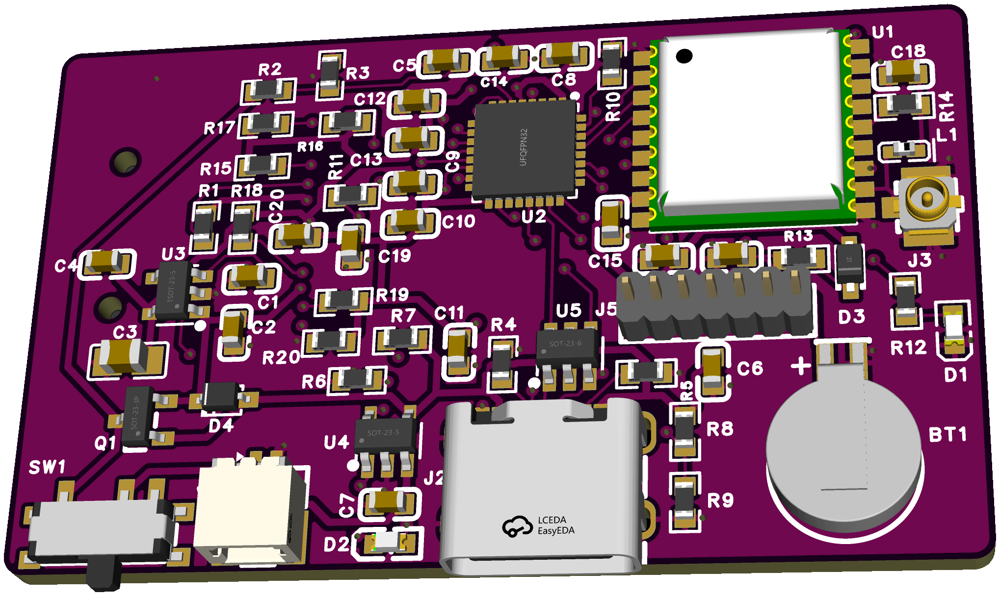
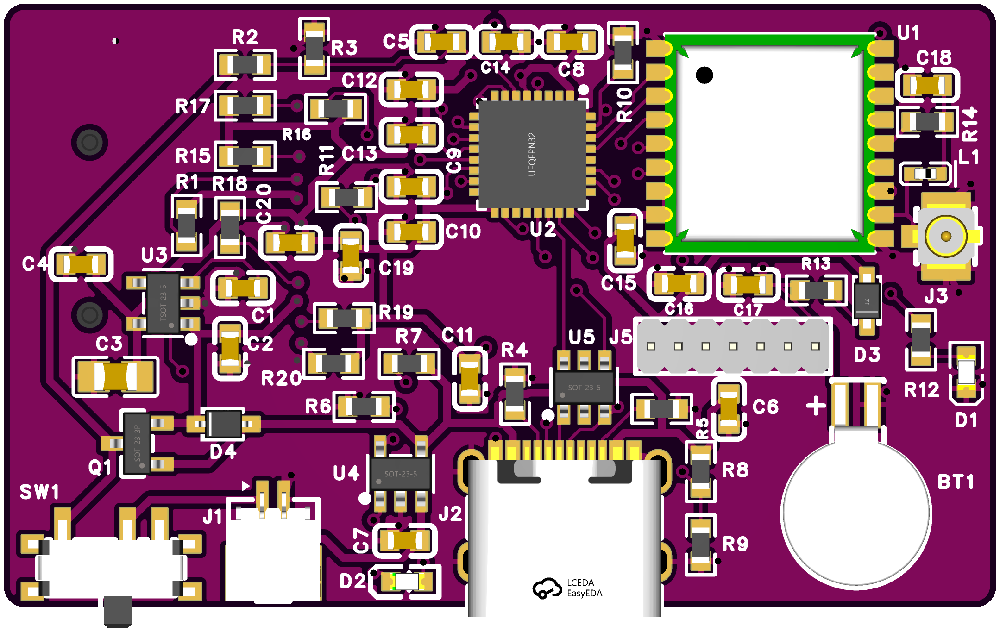
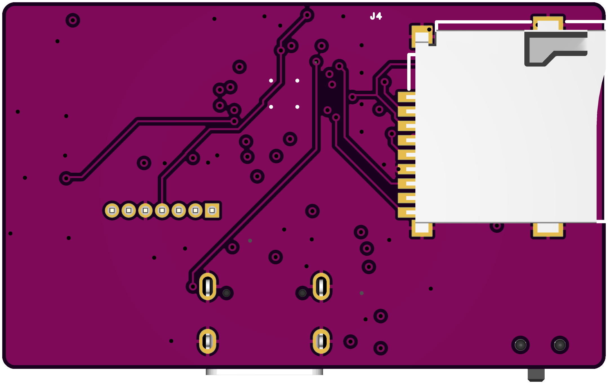

# tiny-gps-logger

A tiny battery-powered GPS logger. It creates a new CSV file on microSD at each start and writes the position about once a second.



*EasyEDA 3D renders, not photos. The board has not been built.*

- 46 × 28 mm, 4-layer board
- u-blox MAX-M10S GNSS module, U.FL antenna connector
- STM32L412KBU6 MCU
- microSD slot on the bottom side
- Li-Po battery with USB-C charging, coin cell for GNSS backup

## Status

| Part | State |
|---|---|
| PCB | Designed in EasyEDA Pro, not yet manufactured |
| Firmware | Alpha: builds and passes host tests, not yet run on hardware |





## Ordering

Files are in [`release/rev1`](release/rev1). Upload `gerber-rev1.zip` and send this instruction:

```text
5PCS, 4 LAYERS, FR4, 1.6MM, OUTER 1OZ, INNER 0.5OZ, STACKUP JLC04161H-3313, NO IMPEDANCE CONTROL, Purple Soldermask, White Legend, ENIG, TENTED VIAS, order number will be added
```

The stack-up is not stored in the Gerbers, so select it when ordering. The open items are in the [design record](docs/DESIGN-RECORD.md).

## Bill of materials

See [`release/rev1/BOM.md`](release/rev1/BOM.md).

## Firmware

C11 on bare metal with STM32Cube LL and FatFs. Commands below are for macOS and run from `firmware/`.

### Install

```sh
brew install cmake ninja dfu-util open-ocd
brew install --cask gcc-arm-embedded
```

- **VS Code (optional):** see [VS Code setup](#vs-code-setup).
- **STM32CubeMX (optional):** needed only to change `firmware.ioc`. After regenerating, check `MX_GPIO_Init` in `Src/main.c`.

### Build

```sh
cmake --preset Release
cmake --build --preset Release
```

The output is `build/Release/tiny-gps-logger.bin`.

| Build | Use | With USB connected |
|---|---|---|
| Release | Real use | Does not log, charges |
| Debug | Bench work and debugging | Logs |

To use Debug, replace `Release` with `Debug` in the commands in this section.

### Flash over USB

No programmer is needed. The first flash on a blank chip:

1. Connect USB-C. The chip starts its bootloader by itself.
2. Run `dfu-util -l` and look for device `0483:df11`. If it is missing, reconnect and try again.
3. Flash:
   ```sh
   cmake --build --preset Release --target flash-dfu
   ```
4. Disconnect and reconnect power.

To update later, remove the card, turn SW1 off, disconnect USB, connect USB again and repeat step 3. With no card and USB connected, the firmware starts the bootloader.

If the firmware does not start, hold J5 pin 6 (BOOT0) at 3V3 during reset, or flash over SWD.

### Flash over SWD

Connect an ST-Link to J5 and power the board from USB or the battery.

| J5 pin | ST-Link |
|---|---|
| 1 | 3V3 (target voltage sense) |
| 2 | SWDIO |
| 3 | SWCLK |
| 4 | NRST |
| 5 | GND |

```sh
cmake --build --preset Release --target flash-swd
```

For step debugging, use a Debug build and the VS Code configuration below.

### VS Code setup

`.vscode/` is not in git, so create it by hand:

1. Install the extensions: clangd (`llvm-vs-code-extensions.vscode-clangd`), CMake Tools (`ms-vscode.cmake-tools`) and Cortex-Debug (`marus25.cortex-debug`).
2. Open the `firmware/` folder, not the repository root.
3. Create `firmware/.vscode/settings.json`:
   ```json
   {
     "cmake.useCMakePresets": "always",
     "C_Cpp.intelliSenseEngine": "disabled",
     "clangd.arguments": [
       "--compile-commands-dir=${workspaceFolder}/build/Debug",
       "--query-driver=/opt/homebrew/bin/arm-none-eabi-*"
     ]
   }
   ```
4. For step debugging with an ST-Link, create `firmware/.vscode/launch.json`:
   ```json
   {
     "version": "0.2.0",
     "configurations": [
       {
         "name": "Debug (ST-Link, J5)",
         "type": "cortex-debug",
         "request": "launch",
         "servertype": "openocd",
         "cwd": "${workspaceFolder}",
         "executable": "${workspaceFolder}/build/Debug/tiny-gps-logger.elf",
         "configFiles": ["interface/stlink.cfg", "target/stm32l4x.cfg"],
         "runToEntryPoint": "main",
         "preLaunchTask": "CMake: build"
       }
     ]
   }
   ```

### Use

Format the card as FAT32. Insert it, turn SW1 on and leave USB disconnected. Each start creates the next `LOGnnnnn.CSV`, and rows are written only with a valid fix. Data reaches the card every 5 s, so a power cut loses a few seconds at most.

At 3.30 V the logger stops and shuts down. Turn SW1 off and on after charging.

| Green LED | State |
|---|---|
| Short blink every 1 s | Searching for a fix |
| Short blink every 5 s | Fix, logging |
| Two fast blinks every 1 s | No card or SD error |
| Four fast blinks every 1 s | GPS not responding |
| Off | Charging, or shut down on low battery |

### Test

```sh
test/run.sh
```

Runs the tests for UBX, CSV, start-up decisions and file logging on the Mac. Hardware code is not covered.

## Repository

| Path | Content |
|---|---|
| [`release/rev1`](release/rev1) | Gerbers, BOM, and placement for ordering |
| [`docs/SPEC.md`](docs/SPEC.md) | PCB specification |
| [`docs/DESIGN-RECORD.md`](docs/DESIGN-RECORD.md) | Design decisions, checks, and open items |
| [`firmware/SPEC.md`](firmware/SPEC.md) | Firmware specification |
| [`firmware/BOARD.md`](firmware/BOARD.md) | Board reference for firmware |

The EasyEDA Pro project is not stored in this repository.
