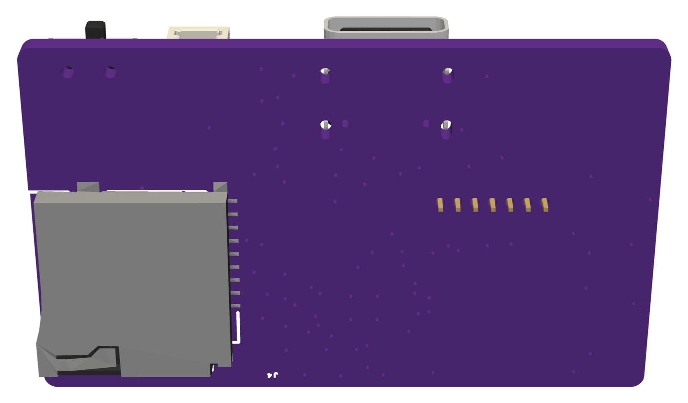

# tiny-gps-logger

A tiny battery-powered GPS logger. It creates a new CSV file on microSD at each start and writes the position about once a second.

*Renders of the 3D model, not photos. Copper is not shown.*

- 46 × 28 mm, 4-layer board
- u-blox MAX-M10S GNSS module, U.FL antenna connector
- STM32L412KBU6 MCU
- microSD slot on the bottom side
- Li-Po battery with USB-C charging, coin cell for GNSS backup

## Status

| Part | State |
|---|---|
| PCB | Designed in EasyEDA Pro, not yet manufactured |
| Firmware | Not started |

## Documents

- [PCB specification](pcb/SPEC.md)
- [Design record](pcb/DESIGN-RECORD.md)
- [Bill of materials](pcb/BOM.md)
- [Board reference for firmware](firmware/BOARD.md)
